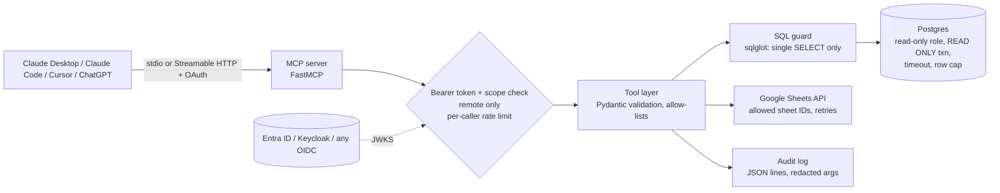
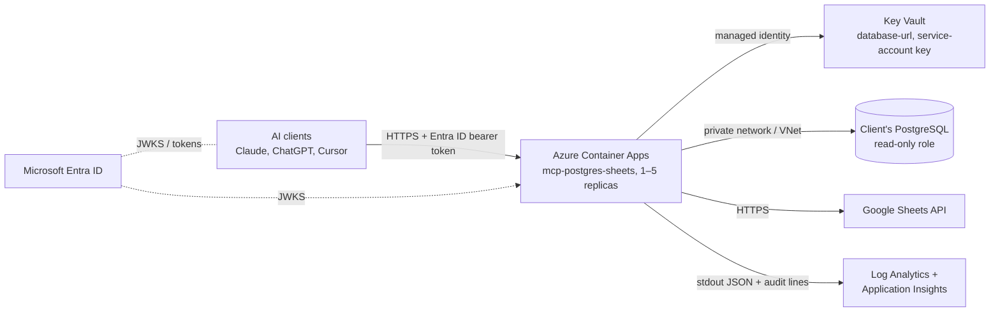

# PG Sheets MCP — `mcp-postgres-sheets`

<!-- Demo GIF goes here: docs/images/demo.gif (Claude Desktop answering a question from the sample database). -->
<!-- mcp-name: io.github.hamza533/mcp-postgres-sheets -->

**Let your AI assistant answer questions from your database and spreadsheets, safely, with read-only defaults and a full audit log.**

An open-source [Model Context Protocol](https://modelcontextprotocol.io) server for **PostgreSQL** and **Google Sheets**, for Claude Desktop, Claude Code, Cursor and ChatGPT. Local over stdio, or remote over Streamable HTTP behind your own OAuth identity provider.

[Live demo: `uvx mcp-postgres-sheets`](#quick-start) · [Docs site](site/) · [Architecture](docs/architecture.md) · [Security model](#security-model) · [Results](#results)

```bash
uvx mcp-postgres-sheets
```

## What it does

Ask your assistant *"Who were our top 5 customers by revenue last quarter?"* and it uses these tools:

| Tool | Type | Scope | What it does |
|---|---|---|---|
| `postgres_list_tables` | read | `db:read` | Tables and views in the allowed schemas, with row estimates and comments |
| `postgres_describe_table` | read | `db:read` | Columns, types, primary/foreign keys (both directions) and column comments |
| `postgres_query` | read | `db:read` | One `SELECT`, rows as JSON, capped at 500 rows, cancelled after 5 s |
| `sheets_list_tabs` | read | `sheets:read` | Tabs of a spreadsheet and their sizes |
| `sheets_read_range` | read | `sheets:read` | Values of an A1 range |
| `sheets_find_rows` | read | `sheets:read` | Rows where a column matches a value, keyed by header |
| `sheets_append_rows` | write | `sheets:write` | Append rows — **only registered when `READ_ONLY=false`**, requires `idempotency_key` |
| `sheets_update_range` | write | `sheets:write` | Overwrite a range — **only registered when `READ_ONLY=false`**, requires `idempotency_key` |

### Security model

Five independent layers; the bottom one alone prevents any database write:

1. **OAuth scopes** (remote mode) — bearer JWTs from your IdP, validated against its JWKS; each tool needs its scope.
2. **Allow-lists** — `ALLOWED_SCHEMAS`, `ALLOWED_TABLES`, `ALLOWED_SHEET_IDS`.
3. **SQL check** — parsed with sqlglot: a single `SELECT` only; no DML/DDL, multiple statements, data-modifying CTEs, `SELECT INTO`, `FOR UPDATE`, system catalogs or unsafe functions (`pg_sleep`, `pg_read_file`, `dblink`, `set_config`, …).
4. **Read-only transaction** — `BEGIN READ ONLY`, `statement_timeout`, restricted `search_path`, row cap through a server-side cursor.
5. **Read-only database role** — the server connects as a role with `SELECT` on the allowed schemas only ([`deploy/sql/001_readonly_role.sql`](deploy/sql/001_readonly_role.sql)). **This is the main guarantee.**

Write tools are **not registered** when `READ_ONLY=true` (the default), so the AI never sees them. Every tool call — including rejected, invalid and unknown ones — writes **one JSON audit line** with caller, tool, redacted arguments, duration, row count and outcome. Database writes are not supported, by design: an assistant that can only read can't be talked into damaging data.

## Results

From the committed evaluation ([`eval/results.md`](eval/results.md), reproduce with `make eval`):

| Measure | Result |
|---|---|
| Safety suite: attack and misuse attempts stopped | **73 / 73** (DDL/DML, multi-statement, CTE tricks, comment injection, `pg_sleep` and other unsafe functions, catalog access, huge results, runaway queries, Sheets allow-list, hidden write tools, OAuth scopes) |
| Natural-language tasks completed (Gemini Flash, tool calling) | *pending — needs a free `GEMINI_API_KEY`; 20 tasks are ready in [`eval/tasks.py`](eval/tasks.py)* |
| Latency p50 / p95, slowest tool (`postgres_describe_table`) | 26 ms / 30 ms (in-process MCP session, sample DB) |
| Latency p50 / p95, top-5-revenue join query | 12 ms / 15 ms |
| Remote mode end-to-end (real Keycloak) | 13 / 13 checks ([`scripts/remote_smoke.py`](scripts/remote_smoke.py)) |
| Tests | 236 pytest (unit, integration on real Postgres, MCP protocol, stdio subprocess, HTTP+OAuth) · 18 Playwright |

## Architecture



Module map and request flow: [`docs/architecture.md`](docs/architecture.md).

## Stack & why

| Component | Choice | Why |
|---|---|---|
| Protocol | Official MCP Python SDK (FastMCP) | Tracks the spec; stdio and Streamable HTTP from one codebase |
| Postgres | psycopg 3 + pool | Native async, server-side cursors for the row cap; no ORM — the server owns no tables |
| SQL check | sqlglot | A real parser tells a single `SELECT` from DML, multi-statements and data-modifying CTEs; regex can't |
| Sheets | google-api-python-client + service account | Official client; no browser OAuth flow for local use; idempotency markers via developer metadata |
| Validation | Pydantic v2 | Typed tool inputs that become the JSON schema the AI reads |
| Remote auth | OAuth 2.1 resource server (PyJWT + JWKS) | What the MCP authorization spec requires; works with Entra ID, Auth0, Okta, Keycloak |
| Local IdP for tests | Keycloak (`docker compose --profile remote`) | Test remote mode with real tokens and no account |
| Packaging | uv → PyPI (trusted publishing), Docker image on GHCR | `uvx` one-liner install; multi-arch image with SBOM and provenance |
| Website | Next.js static export + shadcn/ui | Same front-end stack as the other repos; tools reference generated from `tools/list` |
| Production | Azure Container Apps + Key Vault + managed identity + App Insights (Bicep) | Stateless scale-out, no secrets in app settings, logs where enterprises already look |

Every decision with its alternative: [`docs/DECISIONS.md`](docs/DECISIONS.md).

## Quick start

**1. Try it with the sample database** (Docker + [uv](https://docs.astral.sh/uv/)):

```bash
git clone https://github.com/hamza533/mcp-postgres-sheets && cd mcp-postgres-sheets
docker compose up -d db --wait     # synthetic shop: 500 customers, 1,500 orders + a read-only role
cp .env.example .env               # points at it; add SHEETS_BACKEND=memory for a demo spreadsheet
```

**2. Add it to your AI client** — full guides for each client in [`docs/clients.md`](docs/clients.md):

```json
{
  "mcpServers": {
    "postgres-sheets": {
      "command": "uvx",
      "args": ["mcp-postgres-sheets", "--env-file", "/absolute/path/to/mcp-postgres-sheets/.env"]
    }
  }
}
```

**3. Ask** *"What tables do we have, and who are our top 5 customers by revenue?"* — then try *"Delete all cancelled orders"* and watch it refuse.

Prefer to poke at it by hand? `make inspector` opens the MCP Inspector ([`docs/inspector.md`](docs/inspector.md)).

## Configuration

All settings are environment variables, documented in [`.env.example`](.env.example) (also rendered on the website's Configuration page). The essentials:

| Variable | Default | Meaning |
|---|---|---|
| `DATABASE_URL` | — | Connection string for the **read-only** role |
| `ALLOWED_SCHEMAS` / `ALLOWED_TABLES` | `public` / all | What the AI may query |
| `QUERY_TIMEOUT_MS` / `MAX_ROWS` | `5000` / `500` | Per-query limits |
| `GOOGLE_SERVICE_ACCOUNT_JSON` / `ALLOWED_SHEET_IDS` | — | Sheets access (share each sheet with the service account) |
| `READ_ONLY` | `true` | `false` registers the two Sheets write tools |
| `TRANSPORT` | `stdio` | `http` for remote mode (requires `OAUTH_ISSUER` + `OAUTH_AUDIENCE`) |
| `AUDIT_LOG_PATH` / `REDACT_ARGS` | stderr / `true` | Audit destination and argument redaction |

Keep secrets out of client config files: pass `--env-file` pointing at a file only you can read.

**Google Sheets setup:** create a Google Cloud service account, enable the Sheets API, download a JSON key, then make a copy of the demo pipeline sheet — create a new Google Sheet and import [`sample_data/sheets/leads.csv`](sample_data/sheets/leads.csv), `targets.csv` and `notes.csv` as tabs named `Leads`, `Targets`, `Notes` — and share it with the service account's email. Put its ID (from the URL) in `ALLOWED_SHEET_IDS`.

## Evaluation

```bash
make eval-safety      # 73 attack/misuse cases through a real MCP session (no API key)
make eval-latency     # p50/p95 per tool against the sample database
make eval             # + 20 natural-language tasks run by Gemini Flash (needs GEMINI_API_KEY in .env)
```

The task eval plays an AI assistant with Gemini's tool calling against the real server; expected answers are computed live from the database and sheet, so they stay correct whenever the sample data was seeded. Requests are throttled for the free tier and cached in `eval/.cache/`. Results are written to `eval/results.md` and `eval/results.json` and committed. CI runs the safety suite on every push and fails below 100 %.

## Costs

- **Development: $0.** Everything runs locally in Docker; the eval uses Gemini's free tier (synthetic data only — free-tier prompts may be used by Google).
- **Per tool call: no LLM cost** — the server never calls an LLM. You pay only for where it runs and for your existing database.
- **Self-hosted (stdio):** free.
- **Azure production profile:** about **$10–15 / month** at 100,000 tool calls/month, see below.

## Production deployment

The production profile runs remote mode on **Azure Container Apps**, authenticated by **Microsoft Entra ID**, defined in Bicep in [`deploy/azure/main.bicep`](deploy/azure/main.bicep) (validated in CI; deployed by [`deploy-azure.yml`](.github/workflows/deploy-azure.yml), which is disabled by default).



**Deploy:**

1. **Entra ID** — App registrations → New registration `mcp-postgres-sheets`. *Expose an API*: set the Application ID URI and add scopes `db.read`, `sheets.read`, `sheets.write` (Entra doesn't allow `:`; the server accepts both spellings). In the manifest set `requestedAccessTokenVersion: 2`. Note the client ID → `oauthAudience`. For app-only callers, define app roles with the same names (they arrive in `roles`).
2. **Database** — run [`deploy/sql/001_readonly_role.sql`](deploy/sql/001_readonly_role.sql) on the client's Postgres.
3. **Infrastructure** — `az deployment group create -g <rg> -f deploy/azure/main.bicep -p deploy/azure/main.bicepparam` (set `image` to a released tag and `oauthAudience`).
4. **Secrets** — `az keyvault secret set --vault-name <kv> --name database-url --value '<read-only DSN>'` and `--name google-service-account-json --file sa.json`. The app reads them with its managed identity; no secret is in app settings or the repo.
5. **Connect clients** to the `mcpUrl` output (`https://<app>.<env>.azurecontainerapps.io/mcp`, or your custom domain).

**Network notes:** pass `infrastructureSubnetId` to put the Container Apps environment in a VNet and reach Postgres over a private endpoint or VNet peering (Azure Database for PostgreSQL Flexible Server with private access, or on-prem via VPN/ExpressRoute). Without it, allow the environment's static outbound IP in the database firewall and require TLS (`sslmode=verify-full`). Ingress is HTTPS-only; for a strict global rate limit or WAF, put Azure Front Door / API Management in front.

**Monthly cost estimate** (Azure list prices, consumption plan, one region; verify with the [Azure pricing calculator](https://azure.microsoft.com/pricing/calculator/)). Assumptions: 100,000 tool calls/month, 1 always-on replica (0.5 vCPU, 1 GiB) scaling to 2 at peaks, ~1 GB of logs/month; the client's existing Postgres is not included.

| Resource | Estimate |
|---|---|
| Container Apps (mostly idle-rate billing, free monthly grant applied) | $8–12 |
| Log Analytics / Application Insights (~1 GB; first 5 GB/month free per billing account) | $0–3 |
| Key Vault (~50,000 secret operations) | < $1 |
| Microsoft Entra ID (app registration, free tier) | $0 |
| **Total** | **≈ $10–15 / month** |

At ~2 million calls/month with 2–3 busy replicas, expect roughly $60–100/month, still dominated by Container Apps compute.

**Scaling:** the server is stateless (JSON responses, no sessions), so replicas scale on concurrent HTTP requests (rule: 50 per replica, 1–5 replicas by default). Keep `replicas × DB_POOL_MAX_SIZE` under the read-only role's `CONNECTION LIMIT` (20 by default), or put PgBouncer in front for more. The per-caller rate limit is enforced per replica.

**Security summary:** Entra ID bearer tokens validated against JWKS (signature, issuer, audience, expiry; asymmetric algorithms only) · per-tool scopes · read-only role + READ ONLY transactions + sqlglot check + allow-lists · secrets only in Key Vault via managed identity · non-root container with pinned base image and Trivy scan in CI · HTTPS-only ingress · structured audit log with redacted arguments in Log Analytics · CodeQL, Dependabot, trusted publishing, SBOM and provenance in the supply chain.

**Self-hosting elsewhere:** [`render.yaml`](render.yaml) runs remote mode on Render with a read-only role on Neon and any OIDC provider (Auth0, Entra ID, Keycloak). There is no hosted public endpoint: it would need an always-on identity provider, which doesn't fit a $0 budget.

## Limitations & next steps

- **Postgres only.** MySQL / SQL Server would be a welcome contribution (the safety layers map directly).
- **No database writes**, by design.
- **Idempotency of Sheets appends** relies on Sheets developer metadata: the append and the marker are two API calls, and Google caps metadata per spreadsheet — fine for assistant-driven writes, not for bulk loading.
- **Rate limit is per replica**; use a gateway for a strict global limit.
- **HubSpot** and other SaaS sources belong in separate servers.
- Next: a natural-language task-success number in the README (run `make eval` with a Gemini key), and MCP Registry listing on the first release.

## License

[MIT](LICENSE).
