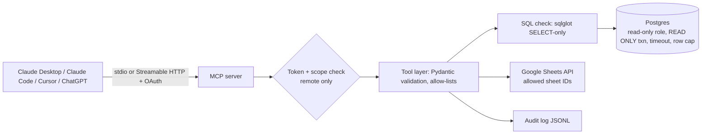

# SPEC – Open-Source MCP Server (PostgreSQL + Google Sheets)
**Repo:** `mcp-postgres-sheets` · **Priority:** 4 · **Follows:** `docs/CONVENTIONS.md`

## 1. Goal
A Model Context Protocol (MCP) server that lets AI assistants (Claude Desktop, Claude Code, Cursor, ChatGPT) safely query a PostgreSQL database and read or write Google Sheets. It's read-only by default, with scoped permissions, input validation and an audit log. It runs locally over stdio or as a remote HTTP server with OAuth. It's published to PyPI and the MCP Registry.

**One-line value statement:** "Let your AI assistant answer questions from your database and spreadsheets, safely, with read-only defaults and a full audit log."

## 2. Who it's for and the problem
Teams that want to ask an AI assistant "what were last month's top customers?" about their own data, but won't hand it unrestricted database or spreadsheet access. It also gives you, as a freelancer, published proof of MCP expertise.

## 3. Scope
### In scope (MVP)
**Tools (8):**

| # | Tool | Type | Description |
|---|---|---|---|
| 1 | `postgres_list_tables` | read | Lists tables and views in allowed schemas, with row-count estimates. |
| 2 | `postgres_describe_table` | read | Columns, types, primary and foreign keys, and column comments. |
| 3 | `postgres_query` | read | Runs one `SELECT` query and returns rows as JSON, with a row limit. |
| 4 | `sheets_list_tabs` | read | Lists tabs and their dimensions for a sheet ID. |
| 5 | `sheets_read_range` | read | Reads an A1 range and returns rows. |
| 6 | `sheets_find_rows` | read | Returns rows where a column matches a value. |
| 7 | `sheets_append_rows` | write | Appends rows. Disabled unless `READ_ONLY=false`. |
| 8 | `sheets_update_range` | write | Updates an A1 range. Disabled unless `READ_ONLY=false`. |

Each tool has a precise description and a Pydantic input schema, because the description is what the AI uses to choose correctly.

**Safety, as layered defenses:**
1. **Database role:** the server connects as a role that only has `SELECT` on allowed schemas. This is the main guarantee, and the README shows the SQL to create the role.
2. **Read-only transaction:** every query runs in `READ ONLY` mode with a `statement_timeout` (default 5 s) and a row cap (default 500).
3. **SQL check:** the query is parsed with `sqlglot` and rejected unless it is a single `SELECT`. This also blocks multiple statements and calls to unsafe functions.
4. **Allow-lists:** `ALLOWED_SCHEMAS`, optional `ALLOWED_TABLES`, and `ALLOWED_SHEET_IDS`.
5. **Write tools:** not registered at all when `READ_ONLY=true`, so the AI never sees them.

**Audit log:** one JSON line per tool call with timestamp, caller identity (from the OAuth token in remote mode, `local` for stdio), tool, arguments with values redacted by config, duration, row count and outcome. It goes to stdout or a file.

**Transports:**
- **stdio** for local use.
- **Streamable HTTP** for remote use. In remote mode the server acts as an OAuth 2.1 resource server, as the MCP authorization spec requires: it validates bearer tokens from any OIDC provider and exposes protected-resource metadata. Scopes are `db:read`, `sheets:read` and `sheets:write`, mapped to tools.

**Setup guides:** Claude Desktop, Claude Code, Cursor and ChatGPT (remote connector), each with a copy-paste config block.

**Publishing:**
- PyPI package `mcp-postgres-sheets`, runnable with `uvx mcp-postgres-sheets`.
- Docker image.
- Entry in the official MCP Registry, plus a submission to one or two popular directories.

**Project website (`/site`):**
- A landing page plus docs: quick start per client, configuration, security model, tools reference and changelog.
- The **tools reference is generated** from the server's own tool schemas, by running `tools/list` at build time, so the docs never drift from the code.
- Statically exported and hosted free.
- Designs live in `docs/ui/`. The Stitch prompt is in `docs/ui/STITCH_PROMPT.md`.

### Out of scope
- Database writes. They're never supported, by design; the README explains why.
- Databases other than Postgres. Note MySQL as a possible contribution.
- HubSpot. Note it as a separate future server.
- Running its own OAuth authorization server. An existing IdP is used.

## 4. Stack (decided)
| Component | Choice | Why |
|---|---|---|
| Language/SDK | Python + official MCP Python SDK (`mcp`, FastMCP API) | The official SDK keeps up with the spec; same language as the other repos. |
| Postgres driver | `psycopg` 3 (with a connection pool) | Standard, async-capable and safe parameter handling. |
| SQL check | `sqlglot` | A real parser is more reliable than regex for rejecting anything that isn't a SELECT. |
| Sheets | Google Sheets API via `google-api-python-client` with a service account | Official client. A service account means no user OAuth flow for local use. |
| Validation | Pydantic v2 | Typed tool inputs that are documented automatically in the tool schema. |
| Remote auth | OAuth 2.1 bearer-token validation (JWT via the IdP's JWKS) | Required by the MCP spec for remote servers, and works with any IdP the client already has (Entra ID, Auth0, Keycloak). |
| Local IdP for testing | Keycloak in a `docker compose --profile remote` profile | Lets anyone test remote mode with OAuth without creating an account. It's only used for testing, never required. |
| Packaging | `uv` build → PyPI; Docker image | `uvx` one-liner install is the standard way MCP servers are installed. |

| Project website | Next.js (static export) + shadcn/ui + Tailwind in `/site`; hosted on Vercel Hobby (free) | Same front-end stack as the other repos. A static site needs no server, so it's free and fast. The tools reference is generated from the code. |

**Not used, on purpose:** a separate docs framework (Docusaurus, Mintlify), TypeScript SDK, an ORM, a custom auth server, any LLM inside the server.

## 4a. Production readiness (CONVENTIONS section 10, adapted)
| Section 10 item | How it applies here |
|---|---|
| Real authentication | OAuth 2.1 bearer tokens from the client's identity provider, with scope checks per tool. There's no built-in user table, because an MCP server should rely on the company's existing IdP. Production uses Microsoft Entra ID; Keycloak is for local testing only. |
| Durable job queue | **Not applicable.** Every tool call is synchronous and short (5 s timeout). |
| Migrations | **Not applicable to the server.** It owns no tables. The read-only role setup is a versioned SQL script in `deploy/sql/`. |
| Stateless containers | Yes. Remote mode keeps no session state beyond the MCP protocol's own, so it can scale out. |
| Timeouts and retries | DB statement timeout. Sheets calls have a timeout and retry with backoff on 429/5xx. Write tools (`sheets_append_rows`, `sheets_update_range`) need an `idempotency_key` argument so retries don't duplicate rows. |
| Input safety | Pydantic schemas, sqlglot check, allow-lists. Error messages never leak connection strings or stack traces. |
| Rate limiting | Per caller identity in remote mode (`RATE_LIMIT_PER_MIN`, default 60). |
| Logs and audit | Structured JSON audit log with request ID and caller. Collected by Application Insights in production. |
| Health checks | `/health` and `/ready` in HTTP mode (ready means the DB and Sheets credentials work). |
| Error tracking | Optional `SENTRY_DSN`. |
| Supply chain | Dependabot, CodeQL, image scan. PyPI releases use **trusted publishing** from GitHub Actions (no API token stored). Signed release tags. |
| Tests | Unit tests, integration tests against real Postgres (compose), the safety suite and an MCP protocol test with the SDK client. Playwright **not applicable** (no UI). |
| Versioning | SemVer, `CHANGELOG.md`, and tool names and schemas treated as a public API: breaking changes only in major versions. |
| Production profile | Azure Container Apps (remote HTTP mode) + Microsoft Entra ID (OAuth) + Key Vault + managed identity + Application Insights, connecting to the client's existing Postgres through a private network. Bicep in `deploy/azure/`, validated in CI, not deployed. |

## 5. Architecture

## 6. Sample data
- `docker compose up` starts Postgres seeded with a small synthetic e-commerce schema (customers, orders, order_items, products) with about 5k rows, plus the read-only role.
- A template Google Sheet is linked from the README for the user to copy, with instructions to share it with the service-account email.

## 7. Evaluation / Results
1. **Safety suite:** at least 40 attack and misuse cases must be blocked, including `DROP`, `UPDATE`, multiple statements, CTE tricks, comment injection, `pg_sleep` and large result sets, plus write tools when read-only and sheets outside the allow-list. Report: N/N blocked.
2. **Task success:** 20 natural-language tasks (for example "top 5 customers by revenue last quarter", "append this row to the leads tab"). An LLM client using Gemini Flash (free tier) with tool calling runs each task against the server, and the result is compared with expected output. Report: success rate and average number of tool calls.
3. **Latency:** p50/p95 per tool against the sample database.

Results go in `eval/results.md` and the README.

## 8. Acceptance criteria
- [ ] `uvx mcp-postgres-sheets` (stdio) works in Claude Desktop and Cursor using the README config. Screenshots or GIF are in the README.
- [ ] Remote mode: `docker compose --profile remote up` starts the server + Keycloak. A request without a token gets 401. A token without `sheets:write` can't append.
- [ ] With `READ_ONLY=true`, write tools don't appear in `tools/list`.
- [ ] Safety suite passes 100% in CI.
- [ ] Every tool call produces one audit line.
- [ ] Published to PyPI and listed in the MCP Registry, with the link in the README.
- [ ] Tested with the MCP Inspector, and steps to do so are documented.
- [ ] Production readiness per section 4a, including:
  - Idempotent write tools.
  - Per-caller rate limit.
  - `/health` and `/ready`.
  - Trusted publishing to PyPI.
  - Playwright smoke test of the project website (pages load, copy buttons work).
  - Bicep validates in CI.
  - README "Production deployment" section covering Entra ID setup, network notes and a monthly cost estimate.
- [ ] Project website builds as a static export, matches `docs/ui/`, and is deployed on Vercel. Its tools reference is generated from `tools/list` in CI, and the build fails if it's out of date.
- [ ] Development MCP servers: `shadcn` in `.mcp.json` for `/site`. Add `neon` only if the README's self-host example is tested on Neon.
- [ ] Everything in CONVENTIONS section 8 is done, including the AI-tool handoff check in section 3a.
- [ ] `AGENTS.md` "Gotchas" lists: the read-only DB role is the main safety guarantee, write tools are hidden when `READ_ONLY=true`, the Keycloak profile is for local testing only, and the safety suite must stay at 100%.
- [ ] **"Live demo" for this project** is the PyPI package (`uvx mcp-postgres-sheets`), plus a GIF and video of it working in Claude Desktop and Cursor against the local sample database. A hosted public endpoint isn't required: it would need an always-on identity provider, which doesn't fit a $0 budget. The README explains how to self-host remote mode, for example on Render with a Neon read-only database.

## 9. Environment variables
`DATABASE_URL` (read-only role), `ALLOWED_SCHEMAS=public`, `ALLOWED_TABLES`, `QUERY_TIMEOUT_MS=5000`, `MAX_ROWS=500`, `GOOGLE_SERVICE_ACCOUNT_JSON`, `ALLOWED_SHEET_IDS`, `READ_ONLY=true`, `TRANSPORT=stdio|http`, `HTTP_PORT`, `OAUTH_ISSUER`, `OAUTH_AUDIENCE`, `AUDIT_LOG_PATH`, `REDACT_ARGS=true`, `RATE_LIMIT_PER_MIN=60`, `SENTRY_DSN` (optional).

## 10. Expected development cost
**$0.**
- Server, PyPI and the MCP Registry: free.
- Task-success eval: Gemini Flash free tier, throttled and cached.
- No hosted endpoint required.

## 11. Upwork case study inputs
- **Problem:** teams want AI over their data without risking it.
- **Solution:** a scoped, audited MCP server.
- **Result:** "8 tools; 40/40 misuse attempts blocked; 19/20 natural-language tasks completed; published on PyPI and the MCP Registry."
