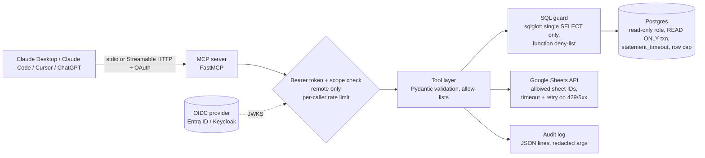

# Architecture

`mcp-postgres-sheets` is a single Python process that speaks the Model Context Protocol over
**stdio** (local) or **Streamable HTTP** (remote). Every tool call passes through the same
pipeline: authorization (remote only) → input validation → allow-lists → the backend
(Postgres or Google Sheets) → one audit line.



## Request flow (remote mode)

```mermaid
sequenceDiagram
  participant Client as MCP client
  participant Srv as mcp-postgres-sheets (HTTP)
  participant IdP as OIDC provider
  participant DB as Postgres
  Client->>Srv: POST /mcp (no token)
  Srv-->>Client: 401 + WWW-Authenticate (resource_metadata=…)
  Client->>Srv: GET /.well-known/oauth-protected-resource
  Srv-->>Client: authorization_servers=[issuer], scopes
  Client->>IdP: OAuth 2.1 flow → access token
  Client->>Srv: POST /mcp tools/call postgres_query (Bearer)
  Srv->>IdP: JWKS (cached)
  Srv->>Srv: verify signature, iss, aud, exp · check scope db:read · rate limit
  Srv->>DB: BEGIN READ ONLY; SET LOCAL statement_timeout; SELECT … LIMIT
  DB-->>Srv: rows
  Srv-->>Client: rows as JSON
  Srv->>Srv: audit line (caller=sub, tool, redacted args, duration, rows, outcome)
```

## Module layout

```
src/mcp_postgres_sheets/
  __main__.py        CLI entry point (`mcp-postgres-sheets`, `python -m mcp_postgres_sheets`)
  config.py          Settings from environment variables (pydantic-settings), validated once at start-up
  server.py          Builds the FastMCP server, registers tools (write tools only when READ_ONLY=false)
  errors.py          ToolError subclasses with safe, user-facing messages (no DSNs, no stack traces)
  sql_guard.py       sqlglot-based check: exactly one SELECT, no unsafe functions, allow-listed tables
  db.py              psycopg 3 async connection pool; READ ONLY transaction, timeout and row cap
  sheets.py          Sheets backend protocol + Google implementation (service account, retries) + in-memory backend
  audit.py           JSON-lines audit logger with argument redaction and request IDs
  auth.py            JWT bearer-token verifier (JWKS), scope → tool mapping, caller identity
  ratelimit.py       Per-caller sliding-window rate limiter (remote mode)
  http_app.py        Streamable HTTP app: /mcp, /health, /ready, protected-resource metadata
  tools/
    postgres.py      postgres_list_tables, postgres_describe_table, postgres_query
    sheets.py        sheets_list_tabs, sheets_read_range, sheets_find_rows, sheets_append_rows, sheets_update_range
    _runtime.py      shared wrapper: scope check → rate limit → run → audit
tests/               unit tests, integration tests (real Postgres), safety suite, MCP protocol tests
eval/                safety suite runner, natural-language task eval (Gemini Flash), latency benchmark
sample_data/         synthetic e-commerce schema + data generator, sample sheet for the in-memory backend
deploy/sql/          versioned SQL for the read-only role
deploy/azure/        Bicep production profile (Container Apps, Key Vault, managed identity, App Insights)
deploy/keycloak/     realm export for the local remote-mode test profile
site/                Next.js static website (docs + generated tools reference)
```

## Safety layers (outermost → innermost)

| # | Layer | Where | What it stops |
|---|---|---|---|
| 1 | OAuth scopes (remote only) | `auth.py`, `tools/_runtime.py` | Callers using tools they weren't granted (`db:read`, `sheets:read`, `sheets:write`). |
| 2 | Allow-lists | `sql_guard.py`, `tools/sheets.py` | Schemas, tables and sheet IDs outside `ALLOWED_SCHEMAS`, `ALLOWED_TABLES`, `ALLOWED_SHEET_IDS`. |
| 3 | SQL check | `sql_guard.py` | Anything but a single `SELECT`: DML/DDL, multiple statements, data-modifying CTEs, `SELECT … INTO`, locking clauses, unsafe functions (`pg_sleep`, `pg_read_file`, `dblink`, `lo_*`, `set_config`, …). |
| 4 | Read-only transaction | `db.py` | Any write that slips through: `BEGIN READ ONLY`, `SET LOCAL statement_timeout`, row cap via `fetchmany`. |
| 5 | Read-only database role | `deploy/sql/001_readonly_role.sql` | **The main guarantee.** The role only has `SELECT` on allowed schemas. |

Write tools (`sheets_append_rows`, `sheets_update_range`) are **not registered** when
`READ_ONLY=true`, so they never appear in `tools/list`.

## Statelessness

The HTTP transport runs in stateless mode (`stateless_http=True`, JSON responses), so any
replica can serve any request. The only in-process state is the JWKS cache and the
per-caller rate-limit window (per replica; see `docs/DECISIONS.md`).
